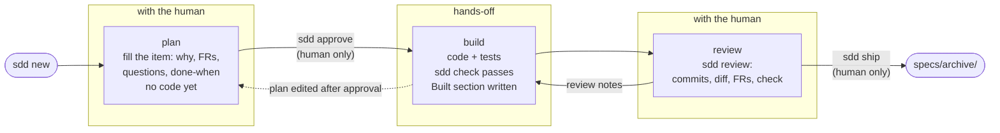

# sdd

Spec-driven changes for people working with coding agents. Humans plan and review; agents
build. One short file per change, plain shell scripts, and any agent.

```
$ .sdd/bin/sdd new feature "Pagination for the orders page"
1 feature · Pagination for the orders page
branch  feature/1-pagination-for-the-orders-page
item    specs/changes/1-pagination-for-the-orders-page/item.md
next    fill in the item, then: .sdd/bin/sdd next
```

## How a change moves

Every change is an **item**: one markdown file, `specs/changes/<id>-<slug>/item.md`, on its
own branch. Its phase is worked out from the file and git each time you ask, never stored.



- **plan.** The agent and the human fill in the item together: the problem first, then
  requirements (`FR-1.1 WHEN … THE SYSTEM SHALL …`) and open questions (`Q-1.1`), one at a
  time. No code.
- **approve.** The human hands the plan to the agent. Approval pins the plan's hash, so
  editing the plan afterwards sends the item back to planning.
- **build.** The agent writes code and tests until `sdd check` passes for exactly this
  code, then writes `## Built`: what changed per FR and which test proves it.
- **review.** `sdd review` walks the human through the commits, diff, FRs and check. Notes
  go under `## Review`, and the agent works through them.
- **ship.** Runs the gates again, archives the item, and fast-forwards `main` locally.
  Pushing stays with you. `sdd tidy` then removes the branches and worktrees shipped items left.
  With `forge = github` in `.sdd/config`, `ship` pushes the branch and opens a pull request
  (the item is its description) instead, and shipping again merges it once CI passes.

`sdd next` always says what to do in the current phase. That is the one command an agent
needs to know.

Not every change takes the full path:

| type | use when | approval |
|---|---|---|
| feature | new behaviour | yes |
| fix | behaviour is wrong; reproduce it with a failing test first | yes |
| refactor | structure only; behaviour and tests stay the same | yes |
| spike | answer a question; only the findings land, never the code | yes |
| chore | dependencies, config, CI, docs | no |
| hotfix | production is broken; write it up after | no |
| amendment | a constitution article must change; every gate blocks | yes |

Changes under about 20 lines with no behaviour change need no item: commit them as
`chore: …`.

## Install into a repo

```sh
/path/to/swe-harness/.sdd/bin/sdd init    # copies .sdd/, writes .sdd/config, adds an AGENTS.md block
.sdd/bin/sdd sync claude                  # optional: hooks and skills for your agent (claude, codex)
```

Requirements: POSIX `sh`, `git` ≥ 2.31, awk, grep and sed. `jq` is needed only for `sync`
and the hooks. Windows works through WSL or Git Bash.

## Commands

| command | what it does |
|---|---|
| `sdd new <type> "title" [--worktree]` | start a change: a branch plus its item file |
| `sdd next` | instructions for the current phase (agents call this) |
| `sdd status` | the current item and its phase, or open items on local branches |
| `sdd approve` | the human hands the plan to the agent |
| `sdd check` | run your tests and linters (exit 0 pass, 1 fail, 3 no tests ran) |
| `sdd review` | walk through what was built |
| `sdd ship` | gates, archive the item, fast-forward the base branch |
| `sdd open <id> [--worktree]` | switch to an item's branch (a teammate's too), or open it in `../<repo>.<id>` |
| `sdd tidy [--remote] [--dry-run]` | remove what shipped items left; `--remote` deletes their remote branches |
| `sdd ls [--all] [--json]` | every item and its progress, across all branches |
| `sdd show <id> [--json]` | one item's stories, requirements, tasks, decisions, questions |
| `sdd summary [--since <when>] [--last <n>] [--mine] [--md]` | recent work as a table |
| `sdd sync <agent>` | per-developer hooks and skills for an agent, never committed |

Every verb exits `0` ok, `1` failed or refused, `2` usage error, `3` ran but proved nothing.

## Working as a team

- **Teammates' work is visible.** `ls`, `show` and `summary` read every local and remote
  branch, so an item on a teammate's pushed branch shows up without merging it.
- **Who did what.** `summary` says who opened each item and who approved it:

  ```
  ┌──────────────────────────┬───────────────────────────────────────┬────────────────────────┬───────────┐
  │ item                     │ state                                 │ who                    │ when      │
  ├──────────────────────────┼───────────────────────────────────────┼────────────────────────┼───────────┤
  │ 3 (Kari's thing)         │ building: no passing check yet        │ kari, approved by lead │ today     │
  ├──────────────────────────┼───────────────────────────────────────┼────────────────────────┼───────────┤
  │ 4 (Faster search)        │ planning: 2 open questions; then      │ joexbayer              │ yesterday │
  │                          │ approval                              │                        │           │
  └──────────────────────────┴───────────────────────────────────────┴────────────────────────┴───────────┘
  ```

  `--md` prints the same rows as a Markdown table for a PR or chat.
- **Nothing to drift.** Phases come from files and git, not a shared state file, so two
  people never see different answers to "where is item 3?".
- **Machine data stays local.** Check results and the ID counter live in `.git/sdd/`, shared
  by all worktrees of a clone and never committed.

- **Pull requests.** With `forge = github`, `ship` opens a PR whose description is the item,
  `status`, `ls` and `review` show its review and CI, and shipping again merges it (only if CI
  passes and GitHub still has exactly the checked commit). Merges are merge commits.

Planned (see the roadmap): unique IDs across clones, PR review as approval, and a read-only
MCP server that shows open items across branches and repos.

## An AI drives, the human decides

An agent reads the `AGENTS.md` block, runs `.sdd/bin/sdd next` and follows it. With
`sdd sync claude` (or `codex`) each developer also gets:

- **one skill per step:** `sdd-new`, `sdd-plan`, `sdd-build`, `sdd-review`, `sdd-ship`;
- **hooks:** the session starts with the current status; an agent that tries to stop with
  unverified code changes is refused once, then told to report it;
- **ask rules (Claude Code):** `approve`, `ship` and `tidy --remote` always need the human's
  click, however the agent spells the command.

Gates are scripts, not prose. In testing with a small local model (qwen3-coder 30B), the
model ignored written rules but obeyed the gates (see `specs/kb/narrow-lessons.md`).

## Constitution

`specs/constitution.md` holds a project's ground truths, one article each (`C-1`, `C-2`, …).
Each article says why it exists and how it is enforced: by a command inside `sdd check`, or
by the human at every review. Articles change only through an `amendment` item, and a
branch that edits the constitution any other way fails `check` and `ship`.

```
C-4 Only new, approve and ship create commits. No verb pushes, except two human-only ones:
  `tidy --remote` deletes remote branches of items already shipped or dropped on the base, and
  `ship` with `forge = github` pushes its own item branch and merges that branch's PR. No verb
  pushes the base branch.
  Why: the human decides what lands and what leaves the machine; both run behind an ask rule,
  and the base changes only through a merge the human started.
  Enforced: check sh tests/constitution/c4-commits.sh
```

## Customise

- **Profiles.** `lite` (default), `standard` or `strict` in `.sdd/config` decide how hard
  each gate is.
- **Types.** Types live in config, so a team can add `migration` or `security-fix`.
- **Overrides.** Put a file at the same path under `.sdd/local/` to override a core file, or
  add `<prompt>.append.md` to extend a prompt.

## Compared with Spec Kit

| | Spec Kit | sdd |
|---|---|---|
| per change | several files (spec, plan, tasks, …) | one `item.md` |
| current feature | a stored pointer file, which can go stale | the branch name |
| progress | read from files | derived from files and git; `ls --json` for tools |
| procedures | agent prompts | POSIX sh scripts; prompts only where judgment is needed |
| gates | written instructions | commands that refuse (`check`, `ship`, the stop hook) |
| approval | none | `sdd approve`, pinned to the plan's hash |
| teams | IDs collide, branches invisible | teammates' branches shown; team IDs planned |

Kept from Spec Kit: greppable requirement IDs, a constitution, a clarify discussion while
planning, and one skill per step. Research and contracts are on the roadmap.

## Learn more

- [specs/design.md](specs/design.md): the design, the roadmap and the reasons behind each choice.
- [specs/kb/](specs/kb/): the research behind them.
- [specs/archive/](specs/archive/): every change to sdd itself, made through sdd.

## Develop

```sh
.sdd/bin/sdd check      # shellcheck + the test suite under sh and dash (this repo uses sdd)
```

Developer notes: [.claude/skills/sdd-dev/SKILL.md](.claude/skills/sdd-dev/SKILL.md).
